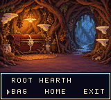
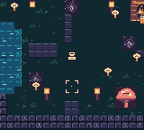
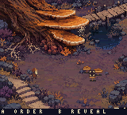

# Fungi Fortress · Chromatic

An **experimental Game Boy Color game** about directing a dwarf through psychedelic fungal environments, gathering resources, and returning to a hideout. It explores queued work, perception-changing spores and spells, and detailed pixel art on constrained hardware. It runs offline in a compatible emulator or on the ModRetro Chromatic.

The experiment also includes a human-reviewed scene authoring pipeline: AI models propose and classify objects in pixel art, a developer reviews navigation and interaction rules, and a compiler turns those rules into a playable test ROM. The game and that pipeline are still being developed; they are not yet one integrated system.

<p>
  
  
  
</p>

*Actual 160×144 emulator frames, enlarged for viewing: integrated hideout, integrated overworld, and the separate Heartwood experiment. The detailed Heartwood scene is not yet the main game's overworld. [Capture provenance](docs/media/README.md).*

## Try it without hardware

**No Chromatic, developer code, Codex plugin or API keys are needed for the offline examples.** Use GB Studio to play the integrated game, or try the scene editor below. A developer code concerns the official Chromatic hardware workflow; it is not needed to build or emulate a ROM. Live AI generation is optional and requires provider credentials.

Install [uv](https://docs.astral.sh/uv/getting-started/installation/), then:

```sh
git clone https://github.com/CameronBeebe/fungi_chromatic.git
cd fungi_chromatic
uv sync --locked
uv run --locked python scripts/test.py
uv run --locked python the-pale-cap/tools/scene_prototype.py example --serve
```

Python 3.12 is selected by `.python-version`; uv manages `.venv` and installs the exact dependency versions in `uv.lock`. The tests also require a C compiler (`cc`). The editor prints a local URL: open it in your browser to inspect recorded Jev scores, paint walkable cells, and change harvest cost, time and yield. **Viewing and editing need no compiler or model calls.** Building a ROM adds GBDK and the optional emulator dependencies; follow the [complete walkthrough](docs/GETTING_STARTED.md).

To play the integrated game, install [GB Studio 4.3.2](https://github.com/chrismaltby/gb-studio/releases/tag/v4.3.2), open `the-pale-cap/project.gbsproj`, and click **Play**. The local engine extension is included. Export ROM produces a native cartridge file; Export Web produces a browser player. [Controls and game details](the-pale-cap/README.md).

## What works today

- **Integrated game — The Pale Cap:** cursor-directed walking and harvesting, a bounded work queue, fungal spells, authored encounters, an illustrated hideout, item inspection/equipment, bag/stash transfers, extraction and hideout-only saves. A valid save boots directly into the hideout. Gillsong's active ability is not implemented; the overworld art remains an early iteration.
- **Standalone native experiments:** rendering and gameplay studies, including Heartwood movement and one harvest patch. Its reveal button is a visual test, not a finished spell. These are separate ROMs, not selectable levels in the integrated game. [Study index](the-pale-cap/art-tests/README.md).
- **Scene authoring tools:** grok-4.3 proposes objects and descriptions; TypeSafe Jev supplies typed judgments, bounds, relationships and before/after checks. Interactive dashboards support human review. The [review-to-ROM adapter](the-pale-cap/art-tests/scene-prototype/README.md) builds one fixed Heartwood room from reviewed settings. **The integrated game's `project/` and `plugins/` do not consume pipeline output yet.**

## Engineering worth exploring

- **Hi-Color rendering:** a full-screen GBDK study and a 104-pixel-high Hearth integrated above GB Studio menus. The renderer updates palettes during display to show more colors. Chromatic playtesting confirmed the room and clean transitions; emulator tests separately check rendering and input.
- **Fault-tolerant saves:** versioned, checksummed records alternate between SRAM banks. Host tests compile the actual C implementation and exercise interrupted writes, corruption, fallback and invalid ownership.
- **Human review tied to the binary:** candidates bind art, evidence and engine source by hash. Reviewed walkability and harvest settings compile into a ROM; emulator checks verify movement, work duration, resource cost, yield and reset before offering a playable result.
- **AI evidence with deterministic limits:** overlapping model judgments inform decisions; graph connectivity, pixel diffs, resource bounds and native tests enforce constraints. Recorded disagreements remain visible. Model confidence is not proof of playability.

The [small offline Heartwood example](examples/heartwood/README.md) includes selected encoded art and recorded model evidence. It is useful for experimenting with the review/build loop without paying for inference. New scenes still require compatible art, gameplay adapters and review; this is not yet a general-purpose level generator.

## Development

`make test` and `make format-check` use the locked uv environment. GitHub Actions runs the offline tests and builds/emulator-tests the standalone examples with GBDK 4.5.0. See the [walkthrough](docs/GETTING_STARTED.md) for prerequisites, browser preview, CI artifacts and current platform coverage. [PLAYTEST.md](the-pale-cap/PLAYTEST.md) distinguishes hardware observations from emulator and host checks.

- [Design](the-pale-cap/DESIGN.md) and [roadmap](the-pale-cap/TODO.md)
- [Scene generation architecture](the-pale-cap/SCENE-GENERATION.md) and [pipeline tools](the-pale-cap/art-tests/jev-scene-probe/README.md)
- [Native engine extensions](the-pale-cap/plugins/README.md)
- [Historical research and experiments](docs/notes/README.md)

The project grew out of [fungi_fortress](https://github.com/CameronBeebe/fungi_fortress), an earlier terminal simulation. This repository is its own native experiment. Richer language/exposure mechanics, generated scene integration, hideout construction, turn-based encounters and link trading remain planned. Live generation and Wi-Fi are outside the offline prototype.

## Assets, credentials and licensing

The broad concept portfolio, generated ROMs, API caches and emulator outputs are ignored. Selected reproducible inputs and original source assets are tracked. Live pipeline runs require explicit `--run` and environment credentials (`XAI_API_KEY`, `TYPESAFE_API_KEY`); credentials never belong in source or browser dashboards.

Original code, documentation and assets are available under [MIT](LICENSE), to the extent of the contributors' rights. Commercial use is permitted; redistributed copies or substantial portions must retain the copyright and license notice. Third-party material retains its own terms; see [THIRD_PARTY_NOTICES.md](THIRD_PARTY_NOTICES.md), including the upstream Hi-Color example's CC0 notice.
