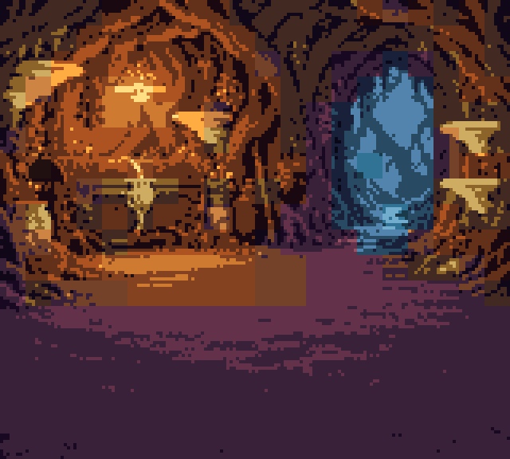

# Fungi Fortress · Chromatic

A Fungi Fortress cartridge prototype for the ModRetro Chromatic, built with GB Studio and custom C for queued work, Hi-Color art and SRAM saves. Its separate development-time scene pipeline uses grok-4.3 for visual proposals and TypeSafe Jev for typed judgments, then lets a human review navigation and harvest rules before compiling a standalone test ROM. The cartridge runs offline; this is an evolving game and tooling project, not a finished release.

<!-- TODO: Add an actual hardware photo or GIF at docs/media/hearth.gif, then embed it here. Do not substitute an emulator capture for hardware footage. -->
*Hardware footage of the Root Hearth is forthcoming.*



*Integrated art, not hardware footage and not an emulator capture: the Root Hearth background after conversion to GBC tiles and palettes, rendered host-side by [`prepare_home.py`](the-pale-cap/tools/prepare_home.py) at 160×144 and scaled 4× (nearest neighbor).*

Adapted from the terminal game harness [fungi_fortress](https://github.com/CameronBeebe/fungi_fortress).

## What works today

- **Integrated game — [The Pale Cap](the-pale-cap/README.md):** cursor-directed walking and harvesting, a bounded work queue, fungal spells, authored encounters, an illustrated hideout, item inspection/equipment, bag/stash transfers, extraction and hideout-only saves. A valid save boots directly into the hideout. Gillsong's active ability is not implemented.
- **Native test ROMs — [study index](the-pale-cap/art-tests/README.md):** isolated rendering and gameplay experiments. Heartwood supports movement and one harvest patch; its reveal button is a visual test, not a finished spell. These are separate cartridges, not selectable levels in the main game.
- **Development tools — [scene pipeline](the-pale-cap/art-tests/jev-scene-probe/README.md):** image proposals, overlapping labels, bounds, relationships and before/after checks, with interactive review dashboards. The [review-to-ROM adapter](the-pale-cap/art-tests/scene-prototype/README.md) builds a one-room Heartwood harness from reviewed settings. **The integrated game's `project/` and `plugins/` do not consume this pipeline's output yet.**

## Highlights

- **Hi-Color on native hardware:** a full-screen GBDK study and a 104-pixel-high Hearth integrated into GB Studio above functional menus. Chromatic playtesting confirmed the room and clean transitions; emulator checks exercise palette stability, short input taps and music cadence/output.
- **Fault-tolerant home saves:** versioned, checksummed records alternate between SRAM banks. Host-side tests compile the actual C implementation and check interrupted writes, byte corruption, fallback and invalid ownership.
- **Evidence tied to the binary:** emulator playtests record ROM hashes and check extraction, transfers, save/cold boot and rendering. Hardware impressions and emulator assertions are distinguished in [PLAYTEST.md](the-pale-cap/PLAYTEST.md).
- **Two-model authoring pipeline:** creative visual proposals become independently judged evidence, human corrections and bounded gameplay data. Exact tile/pixel checks complement model judgments; model confidence is not treated as proof of playability.

## Quick start

For offline tests, use Python 3.10+ and a C compiler (`cc`):

```sh
python3 -m venv .venv
. .venv/bin/activate
python -m pip install -r requirements-dev.txt
make test
```

The single test command runs native save/inventory tests and all scene-tool unit tests. It needs no ROM, private artwork or API credentials. GitHub Actions runs the same command and `make format-check`.

For the integrated game, open `the-pale-cap/project.gbsproj` in GB Studio 4.3.x and build/export a Game Boy Color ROM. Keep the local `plugins/colony-controls` engine extension enabled. The development build used GB Studio 4.3.2 and GBDK 4.5.0 supplied by the ModRetro Chromatic toolchain; installed build tools are external dependencies. The source and required integrated art are checked in. This cleanup verifies the standalone build below, not a new integrated-game build.

For the reproducible Hi-Color comparison ROM, install GBDK-2020 with `lcc` and `png2hicolorgb`, then:

```sh
export GBDK_PATH=/path/to/gbdk
sh the-pale-cap/art-tests/hearth-hicolor/build.sh
```

Output: `the-pale-cap/art-tests/hearth-hicolor/bin/hearth-hicolor.gbc`. All inputs for this demo are in the repository. The other local art studies explicitly identify any missing concept input; see their READMEs. PyBoy is an optional dependency for native ROM playtests (`python -m pip install pyboy`).

## Read the project

- [Game controls and implementation](the-pale-cap/README.md)
- [Design](the-pale-cap/DESIGN.md) and [short roadmap](the-pale-cap/TODO.md)
- [Scene generation architecture](the-pale-cap/SCENE-GENERATION.md)
- [Native engine extensions](the-pale-cap/plugins/README.md)
- [Historical research and experiments](docs/notes/README.md)

The earlier terminal simulation lives in [fungi_fortress](https://github.com/CameronBeebe/fungi_fortress). This repository implements a small native adaptation, not the whole Python simulation. Planned systems include richer language/exposure mechanics, generated scene integration, hideout construction, turn-based encounters and link trading; live generation and Wi-Fi are outside the offline prototype.

## Assets, credentials and licensing

The broad `concept-art/` portfolio, generated ROMs, API caches and emulator outputs are ignored. Selected build inputs and existing notices remain tracked. Optional live pipeline runs require an explicit `--run` and environment credentials (`XAI_API_KEY`, `TYPESAFE_API_KEY`); no credentials belong in source or browser dashboards.

Original project code, documentation and assets are available under the [MIT license](LICENSE), to the extent of the contributors' rights in that material. Commercial use is permitted; redistributed copies or substantial portions must retain the copyright and license notice. There is no separate restriction on original artwork.

Third-party material retains its own terms; see [THIRD_PARTY_NOTICES.md](THIRD_PARTY_NOTICES.md). The upstream Hi-Color GBDK example source is covered by its CC0 notice. The existing `the-pale-cap/LICENSE` preserves GB Studio's MIT attribution and does not replace the root project license.
